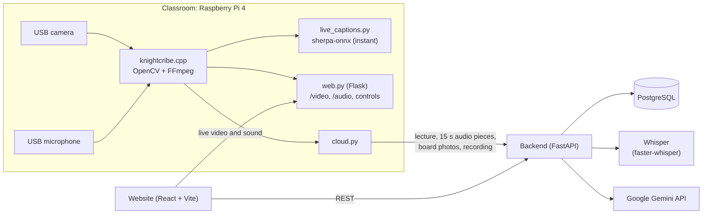

# Knight Scribe

KnightScribe turns live lectures into searchable memory by connecting what professors say, write, and show.

We put a Raspberry Pi with a camera and a microphone in the classroom. While the professor teaches, it
streams the lecture, writes down what's said, and takes a photo of the board every time something new gets
written on it. Afterwards everything is on the website: the recording, the transcript, the board photos, a
summary, practice questions, and a place to ask questions about the lecture.

Built over one weekend for a hackathon by Larry Lekin, Gustavo Dizeu, Yoni Ramos and Elionel Jack Vertus.

## What you can do with it

Students can watch a lecture live with sound or rewatch it later. Click a line of the transcript, a board
photo or a point in the summary and the video jumps there. You can search everything said in a course,
download the professor's slides, take a practice quiz, and ask questions that get answered from the course
material.

Professors start the lecture from the website, upload their slides or notes, and choose how much help
students get.

## How it works



1. **Capture** (`knightcribe.cpp`): one FFmpeg process reads the 720p camera and the microphone. It records
   the video in 5-minute pieces, the audio, and 15-second audio clips for the transcript, and keeps a live
   picture for the website. The teaching area is marked with 4 corners and straightened with OpenCV's
   perspective transform. When the writing on it changes and NanoDet sees nobody in the way, the board gets
   photographed, along with a cleaned-up copy that's easier to read.
2. **Sending** (`cloud.py`, started by `web.py`): creates the lecture on the backend and marks it live, sends
   each finished audio clip off to be transcribed, posts the board photos, and refreshes the summary every
   minute. When the lecture ends it compresses and uploads the recording and asks for the final summary and
   practice questions.
3. **Backend** (`backend/`): keeps everything in PostgreSQL, runs Whisper on the audio, uses Gemini for the
   summaries, practice questions and Q&A, and handles search, recordings and documents.
4. **Website** (`frontend/`): the student and teacher pages. Live video and sound come straight from the Pi.

## How we got here

Almost nothing worked the first time. We started with Whisper running on the Raspberry Pi, but the Pi was
too slow for anything but the smallest model, so the transcript lagged 20 seconds or more and barely made sense.
We moved Whisper to the laptop running the backend and gave the Pi a lighter streaming model for live
captions. Then the transcripts came back completely empty, and after a lot of debugging it turned out the
microphone was recording pure silence.

Getting the Pi and the website to agree took most of a night. Lectures closed themselves the second they
started because of a timing gap in our sync script, the backend's "go live" endpoint crashed on every call,
every recording showed up twice, and the browser blocked requests between the website, the backend and the
Pi until we set up CORS on each one. The text the Pi read off the whiteboard was mostly wrong, so we show
cleaned-up photos of the board instead, and since browsers couldn't play the Pi's recordings, we join and
shrink them with FFmpeg first.

The night before the demo, the teammate with access to our hosting wasn't around, so we moved the database
and backend onto a laptop and spent a while getting the Pi to reach it through Docker, Windows and a phone
hotspot. And the Pi is still called `knightcribe.local`, missing an "s". It was a typo early on and it stuck.

## What's in this repo

- `frontend/` is the website (React, TypeScript, Vite).
- `backend/` is the server (FastAPI). `main.py` is the core API; the other files cover the Q&A, summaries and
  quizzes, transcription, recordings, documents and search.
- At the top level is the classroom device: `knightcribe.cpp` (capture), `web.py` (the Pi's control page and
  live streams), `cloud.py` (sends lectures to the backend), `live_captions.py`, `export.py`, and the setup
  scripts `pi_start.sh` and `send_code.cmd`. [`CLASSROOM_DEVICE.md`](CLASSROOM_DEVICE.md) explains the device
  in detail.

## Running it

You'll need Python 3.12 or newer, Node.js 22, and a free Gemini API key from
[Google AI Studio](https://aistudio.google.com/apikey).

Backend (Linux or a dev container):
```bash
cd backend
python3 -m venv .venv && source .venv/bin/activate
pip install -r requirements.txt -r requirements-whisper.txt
cp .env.example .env            # put your Gemini key in here
bash setup_local_db.sh          # first time only: local database and a demo course
bash start_local.sh             # runs on http://localhost:8000
```
The first start downloads the Whisper model (around 500 MB), so give it a minute.

Website:
```bash
cd frontend
npm install
npm run dev -- --host 0.0.0.0   # then open http://localhost:5173
```

Classroom device: from Windows, double-click `send_code.cmd`. It copies the code to the Pi, installs what's
missing and starts everything. To point the Pi at your backend, put the backend's address in a file called
`backend.txt` next to `cloud.py` on the Pi (for example `http://192.168.137.153:8000`). The Pi and the laptop
need to be on the same network. More in [`CLASSROOM_DEVICE.md`](CLASSROOM_DEVICE.md).

Settings live in `backend/.env` (database, Gemini key, Whisper model) and `frontend/.env` (where the backend
and the Pi are). While the backend runs, you can browse the API at `http://localhost:8000/docs`.

## Team

- **Larry Lekin**: the website, and tying the website, backend and Pi together
- **Gustavo Dizeu**: the backend and database
- **Yoni Ramos**: the Gemini setup and prompts, and accounts
- **Elionel Jack Vertus**: the classroom device (camera, board detection, captions, live streams)

## Credits

Thanks to the people behind the projects we built on:

- [Whisper](https://github.com/openai/whisper) by OpenAI, run with [faster-whisper](https://github.com/SYSTRAN/faster-whisper): the transcript
- [sherpa-onnx](https://github.com/k2-fsa/sherpa-onnx): live captions on the Pi
- [NanoDet](https://github.com/RangiLyu/nanodet): person detection
- [OpenCV](https://opencv.org/): the teaching area and its 4-corner perspective transform
- [Google Gemini](https://ai.google.dev/): summaries, practice questions and Q&A
- [FFmpeg](https://ffmpeg.org/): recording and compressing the video
- [React](https://react.dev/) and [Vite](https://vite.dev/) for the website, [FastAPI](https://fastapi.tiangolo.com/) and [PostgreSQL](https://www.postgresql.org/) for the backend, [Flask](https://flask.palletsprojects.com/) on the [Raspberry Pi](https://www.raspberrypi.com/)
- [Claude Code](https://www.anthropic.com/claude-code) and other AI coding assistants helped us write and debug parts of the code

The black and gold colors are a nod to UCF. Knight Scribe is a student hackathon project and isn't
affiliated with or endorsed by the University of Central Florida.

## License

MIT (see [`LICENSE`](LICENSE)). The projects we used keep their own licenses.
