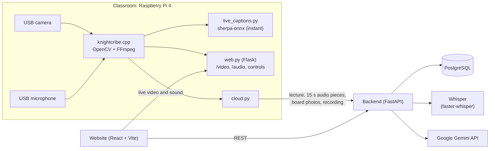

# Knight Scribe

**Knight Scribe turns a live lecture into searchable, AI-assisted study material while it is happening.**
A Raspberry Pi in the classroom records what the professor says, writes and shows. Students follow the
lecture live (video and sound) or rewatch it later, and get an accurate transcript, photos of the board,
an AI summary, practice questions and an AI tutor that answers only from their own course material.

Built in one weekend for a hackathon by Larry Lekin, Gustavo Dizeu, Yoni Ramos and Elionel Jack Vertus.

---

## What it does

**For students**
- **Watch live**: the classroom camera and microphone, streamed from the Pi, with a live transcript.
- **Rewatch**: every lecture's recording, stored by the backend and seekable.
- **Accurate transcript**: speech is transcribed with OpenAI's Whisper; click any line to jump the video there.
- **Board & slides**: cleaned, high-contrast photos of the whiteboard and slides, taken automatically
  whenever the writing changes and nobody is standing in front of it. Each photo jumps to its moment.
- **AI summary**: timestamped key points, rewritten every minute during the lecture and finalized after it.
- **AI tutor chat**: answers *only* from the professor's documents, the lecture transcript and the lecture
  video itself, cites its sources, and links each citation to the moment in the video. Modes: Ask, Hint,
  Explain, Final answer.
- **Practice quiz**: AI-written multiple-choice questions; answers are checked by the server.
- **Search** everything said and uploaded in a course, and jump straight to the moment.
- **Reference material**: download the professor's PDFs and slides.

**For professors**
- Start a live lecture (with a title) from the website; camera status, temperature and storage at a glance.
- Upload reference material (PDF, PowerPoint, text) that the AI may cite.
- Course settings that the server enforces: AI on/off, hints, explanations, final answers, practice
  questions, rewatching recordings.
- Generate or regenerate the AI summary and quiz for any lecture; write practice questions by hand.

## How it works



1. **Capture** (`knightcribe.cpp`): one FFmpeg process reads the 720p MJPEG camera and the microphone. It
   records H.264 video in 5-minute pieces, FLAC audio and 15-second WAV pieces for transcription, and keeps a
   live picture for the website. OpenCV finds the board, NanoDet checks nobody is in front of it, and the
   board is photographed (plus a cleaned, saturated copy) when the writing changes. Tesseract reads its text
   for the Pi's own page.
2. **Sending** (`cloud.py`, started by `web.py`): creates the lecture on the backend, marks it live with the
   camera link, uploads each finished audio piece for Whisper, posts board photos, asks for an AI summary
   every minute, and after the lecture compresses and uploads the recording and asks for the final summary
   and quiz.
3. **Backend** (`backend/`): stores everything in PostgreSQL, transcribes audio with Whisper, runs Gemini for
   the chat, summaries and quizzes (grounded in course material only), stores recordings and documents, and
   serves search (PostgreSQL full-text search).
4. **Website** (`frontend/`): student and teacher dashboards. Live video and sound come straight from the Pi.

## Repository layout

| Path | What it is |
|---|---|
| `frontend/` | The website: React 19 + TypeScript + Vite. `src/backend.ts` talks to the backend; the teacher page also talks to the Pi. |
| `backend/` | FastAPI backend. `main.py` (core API), `chat.py` (AI tutor), `lecture_video.py` (video for the AI), `ai_generate.py` (summaries, quizzes), `whisper_transcribe.py`, `recordings.py`, `document_files.py`, `search.py` / `retrieval.py`, `ai_service.py` / `prompts.py` / `schemas.py` (Gemini), `auth.py` / `permissions.py`, `schema.sql`. |
| `knightcribe.cpp`, `CMakeLists.txt` | The Pi's capture program (C++ / OpenCV). |
| `web.py` | The Pi's control page and live streams (Flask). |
| `cloud.py` | Sends lectures from the Pi to the backend. |
| `live_captions.py` | Instant streaming captions on the Pi (sherpa-onnx). |
| `export.py` | Packages a finished lecture for LLMs / databases. |
| `pi_start.sh`, `send_code.cmd`, `test_camera.sh`, `bench_capture.py` | Pi setup, deployment from Windows, camera checks. |
| [`CLASSROOM_DEVICE.md`](CLASSROOM_DEVICE.md) | Full documentation of the classroom device. |

## Running it

**1. Backend** (Linux or a dev container; Python 3.12+)
```bash
cd backend
python3 -m venv .venv && source .venv/bin/activate
pip install -r requirements.txt -r requirements-whisper.txt   # Whisper is optional
cp .env.example .env            # add your Gemini API key
bash setup_local_db.sh          # once: local PostgreSQL database + demo course
bash start_local.sh             # API on http://localhost:8000, docs at /docs
```
The first start downloads the Whisper model (about 500 MB for `small.en`).

**2. Website** (Node.js 22)
```bash
cd frontend
npm install
npm run dev -- --host 0.0.0.0   # open http://localhost:5173
```

**3. Classroom device**: see [`CLASSROOM_DEVICE.md`](CLASSROOM_DEVICE.md). From Windows, `send_code.cmd`
copies the code to the Pi, installs what is missing and starts it. To send lectures to your backend, put its
address in `backend.txt` next to `cloud.py` on the Pi (one line, for example `http://192.168.137.153:8000`).
The Pi and the laptop must be on the same network.

### Configuration

| Where | Setting | Meaning |
|---|---|---|
| `backend/.env` | `DATABASE_URL` | PostgreSQL connection (set by `start_local.sh` for the local database). |
| | `GEMINI_API_KEY`, `GEMINI_MODEL` | Google Gemini key and model (default `gemini-3.5-flash-lite`). |
| | `WHISPER_MODEL`, `WHISPER_THREADS` | Whisper model (default `small.en`) and CPU threads. |
| `frontend/.env` | `VITE_API_BASE_URL` | The backend's address. |
| | `VITE_PI_BASE_URL`, `VITE_PI_STREAM_URL` | The Pi's control page and live video. |
| Pi: `backend.txt` | | The backend's address for `cloud.py` (default: the hosted backend). |
| Pi: `course.txt` | | Which course new lectures belong to (optional). |

### Main API endpoints

| Area | Endpoints |
|---|---|
| Courses & settings | `GET /courses`, `GET/PUT /courses/{id}/settings`, `GET /courses/{id}/lectures` |
| Lectures (from the Pi) | `POST /lectures`, `PUT /lectures/{id}/stream`, `POST /lectures/{id}/end`, `PUT /lectures/{id}/complete`, `POST /lectures/{id}/board-events` |
| Transcription | `PUT /lectures/{id}/audio/{n}` (Whisper), `GET /lectures/{id}/audio/pending`, `GET /whisper`, `POST /lectures/{id}/transcript` |
| Recordings | `PUT/GET /lectures/{id}/recording` (range requests for seeking) |
| AI | `POST /courses/{id}/ask` (tutor), `POST /lectures/{id}/summary/generate`, `POST /lectures/{id}/quiz/generate` |
| Study | `GET /lectures/{id}`, `GET /lectures/{id}/board-events`, `GET/POST /lectures/{id}/quiz-questions`, `POST /quiz-questions/{id}/answer`, `GET /courses/{id}/search` |
| Reference material | `POST /courses/{id}/documents/upload`, `GET /courses/{id}/documents`, `GET /courses/{id}/documents/{doc}/file` |

Interactive documentation: `http://localhost:8000/docs` while the backend runs.

## Team

| | Role |
|---|---|
| **Larry Lekin** | Website (student and teacher dashboards) and integration of the website, backend, AI and Pi |
| **Gustavo Dizeu** | Backend and database (FastAPI, PostgreSQL, lecture ingestion, search, reference material) |
| **Yoni Ramos** | AI (Gemini service and prompts, permissions, accounts) |
| **Elionel Jack Vertus** | Classroom device (Raspberry Pi capture, board detection, transcription, live streams) |

## Credits and acknowledgements

Knight Scribe is built on the work of many open-source projects and services. Thank you to all of them.
Each one is used under its own license; see the linked projects.

### AI models and AI services
| What | Used for |
|---|---|
| [Google Gemini API](https://ai.google.dev/) (model `gemini-3.5-flash-lite`) and [Google AI Studio](https://aistudio.google.com/) | AI tutor chat (including watching the lecture video), lecture summaries, practice quizzes |
| [Google Gen AI Python SDK](https://github.com/googleapis/python-genai) (`google-genai`) | Calling Gemini, uploading lecture videos to Gemini's file storage |
| [Whisper](https://github.com/openai/whisper) by OpenAI (model `small.en`) | Accurate lecture transcription |
| [faster-whisper](https://github.com/SYSTRAN/faster-whisper) by SYSTRAN, on [CTranslate2](https://github.com/OpenNMT/CTranslate2) by OpenNMT | Running Whisper fast on a laptop CPU |
| [Silero VAD](https://github.com/snakers4/silero-vad) (bundled with faster-whisper) | Skipping silence before transcription |
| [Hugging Face Hub](https://huggingface.co/) | Downloading the Whisper model files |
| [sherpa-onnx](https://github.com/k2-fsa/sherpa-onnx) by k2-fsa (Next-gen Kaldi), streaming Zipformer English model `sherpa-onnx-streaming-zipformer-en-20M-2023-02-17` | Instant captions on the Raspberry Pi |
| [ONNX Runtime](https://onnxruntime.ai/) | Runs the sherpa-onnx and Silero VAD models |
| [NanoDet](https://github.com/RangiLyu/nanodet) from the [OpenCV Model Zoo](https://github.com/opencv/opencv_zoo) | Detecting a person in front of the board |
| [Tesseract OCR](https://github.com/tesseract-ocr/tesseract) | Reading board and slide text on the Pi |

### Website
| What | Used for |
|---|---|
| [React](https://react.dev/) 19 | User interface |
| [TypeScript](https://www.typescriptlang.org/) | Typed JavaScript |
| [Vite](https://vite.dev/) with [Rolldown](https://rolldown.rs/) and [@vitejs/plugin-react](https://github.com/vitejs/vite-plugin-react) | Development server and build |
| [React Compiler](https://react.dev/learn/react-compiler) (`babel-plugin-react-compiler`), [Babel](https://babeljs.io/) | Automatic React optimizations |
| [ESLint](https://eslint.org/), [typescript-eslint](https://typescript-eslint.io/), `eslint-plugin-react-hooks`, `eslint-plugin-react-refresh`, `globals` | Code checks |
| [Node.js](https://nodejs.org/) and [npm](https://www.npmjs.com/) | JavaScript runtime and packages |
| [Google Fonts](https://fonts.google.com/): [Sora](https://fonts.google.com/specimen/Sora) and [Special Elite](https://fonts.google.com/specimen/Special+Elite) | Typography |
| Web platform: Web Audio API, Fetch streams, MJPEG in `` | Live sound and live video in the browser |
| Vite's project template | Starting point of the frontend (favicon) |

### Backend
| What | Used for |
|---|---|
| [FastAPI](https://fastapi.tiangolo.com/) with [Starlette](https://www.starlette.io/), [Pydantic](https://docs.pydantic.dev/) and [Uvicorn](https://www.uvicorn.org/) | The web API |
| [PostgreSQL](https://www.postgresql.org/) (full-text search with `tsvector`) | Database and search |
| [Neon](https://neon.tech/) | Hosted PostgreSQL during development |
| [psycopg 3](https://www.psycopg.org/) | PostgreSQL driver |
| [python-dotenv](https://github.com/theskumar/python-dotenv) | Settings from `.env` |
| [pypdf](https://github.com/py-pdf/pypdf) and [python-pptx](https://github.com/scanny/python-pptx) | Reading uploaded PDFs and PowerPoints |
| [argon2-cffi](https://github.com/hynek/argon2-cffi) and [email-validator](https://github.com/JoshData/python-email-validator) | Accounts (password hashing, email checks) |
| [NumPy](https://numpy.org/) | Audio samples for Whisper (PyAV and ONNX Runtime come with faster-whisper) |
| [Render](https://render.com/) | Hosting the backend during development |

### Classroom device
| What | Used for |
|---|---|
| [Raspberry Pi 4](https://www.raspberrypi.com/products/raspberry-pi-4-model-b/) (4 GB) with Raspberry Pi OS (Debian) | The classroom computer |
| USB MJPEG camera (720p30) and USB microphone | Capture |
| [OpenCV](https://opencv.org/) (C++ and Python) | Board detection, image cleanup, person detection (DNN), live picture resizing |
| [FFmpeg](https://ffmpeg.org/) (V4L2 and ALSA input, `h264_v4l2m2m` hardware encoder, libx264, AAC, FLAC) | Recording, audio pieces, live picture, compressing recordings |
| [Video4Linux](https://www.linuxtv.org/) (`v4l-utils`) and ALSA | Camera and microphone access |
| [Flask](https://flask.palletsprojects.com/) | The Pi's control page and live streams |
| [CMake](https://cmake.org/) and GCC | Building the capture program |
| mDNS (`knightcribe.local`) and Windows Mobile Hotspot | Finding the Pi on the classroom network |
| [Cloudflare Tunnel](https://developers.cloudflare.com/cloudflare-one/connections/connect-networks/) | Sharing the live camera during development |

### Development tools
| What | Used for |
|---|---|
| [GitHub](https://github.com/) | Code hosting and collaboration |
| [Visual Studio Code](https://code.visualstudio.com/) with [Dev Containers](https://containers.dev/) and [Docker](https://www.docker.com/) (Microsoft dev container images) | Development environment |
| [Claude Code](https://www.anthropic.com/claude-code) by Anthropic, and other AI coding assistants | Help writing, testing and debugging parts of the code |

### Branding
Knight Scribe uses a black and gold color scheme inspired by the University of Central Florida. It is a
student hackathon project and is not affiliated with or endorsed by UCF.

## License

Knight Scribe is released under the MIT License (see [`LICENSE`](LICENSE)). Third-party software, models,
fonts and services keep their own licenses and terms.
