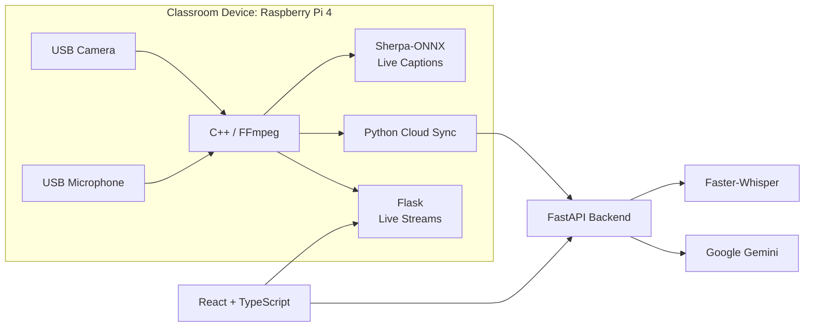

# Knight Scribe

Knight Scribe turns live lectures into searchable memory by connecting what professors say, write, and show.

A Raspberry Pi with a camera and microphone captures lectures, generates live captions, and photographs the whiteboard when writing changes. The website provides recordings, transcripts, board photos, AI summaries, practice quizzes, searchable course content, and lecture-based Q&A.

Built in one weekend for a hackathon by Larry Lekin, Gustavo Dizeu, Yoni Ramos, and Elionel Jack Vertus.

## Features

- Live lecture video, audio, and captions
- Searchable transcripts and course materials
- Timestamp-linked transcripts, board photos, and summaries
- AI-generated summaries, quizzes, and Q&A
- Professor controls and slide uploads

## Architecture



## Tech Stack

| Component | Technologies |
|---|---|
| Hardware | Raspberry Pi 4, USB camera, USB microphone |
| Frontend | React, TypeScript, Vite |
| Backend | Python, FastAPI, Flask |
| AI & Vision | Faster-Whisper, Sherpa-ONNX, Gemini, OpenCV, NanoDet |
| Media Processing | FFmpeg |

## Getting Started

### Prerequisites

- Python 3.12+
- Node.js 22
- A [Google Gemini API key](https://aistudio.google.com/apikey)

### 1. Start the Backend

```bash
cd backend

python3 -m venv .venv
source .venv/bin/activate

pip install -r requirements.txt -r requirements-whisper.txt

cp .env.example .env
```

Add your Gemini API key and configure the environment variables in `backend/.env`.

Initialize the local environment and start the server:

```bash
bash setup_local_db.sh
bash start_local.sh
```

The backend runs at `http://localhost:8000`. API documentation is available at `http://localhost:8000/docs`.

### 2. Start the Frontend

Open another terminal:

```bash
cd frontend
npm install
npm run dev -- --host 0.0.0.0
```

Open the Vite URL displayed in your terminal, usually `http://localhost:5173`.

### 3. Set Up the Classroom Device

On Windows, run `send_code.cmd` to deploy the classroom software to the Raspberry Pi.

Configure `backend.txt` beside `cloud.py` on the Pi with the backend's network address:

```text
http://192.168.137.153:8000
```

Replace the example address with your backend machine's actual IP address. Both devices must be connected to the same network.

See [`CLASSROOM_DEVICE.md`](CLASSROOM_DEVICE.md) for detailed setup instructions.

## Repository Structure

```text
.
├── frontend/             # React + TypeScript website
├── backend/              # FastAPI backend
├── knightcribe.cpp       # Camera, audio, and board capture
├── web.py                # Pi controls and live streams
├── cloud.py              # Backend synchronization
├── live_captions.py      # Real-time speech recognition
├── export.py             # Export utilities
├── pi_start.sh           # Raspberry Pi startup script
├── send_code.cmd         # Windows deployment script
└── CLASSROOM_DEVICE.md   # Classroom device documentation
```

## Team

- **Larry Lekin** — Frontend development and system integration
- **Gustavo Dizeu** — Backend and database
- **Yoni Ramos** — Gemini integration, prompts, and accounts
- **Elionel Jack Vertus** — Classroom device, board detection, captions, and live streaming

## Credits

- [Whisper](https://github.com/openai/whisper) and [faster-whisper](https://github.com/SYSTRAN/faster-whisper) — transcription
- [sherpa-onnx](https://github.com/k2-fsa/sherpa-onnx) — live captions
- [NanoDet](https://github.com/RangiLyu/nanodet) — person detection
- [OpenCV](https://opencv.org/) — image processing and perspective correction
- [Google Gemini](https://ai.google.dev/) — summaries, quizzes, and Q&A
- [FFmpeg](https://ffmpeg.org/) — recording and media processing
- [React](https://react.dev/), [Vite](https://vite.dev/), [FastAPI](https://fastapi.tiangolo.com/), and [Flask](https://flask.palletsprojects.com/) — application infrastructure

Claude Code and other AI coding assistants helped with development and debugging.

The black-and-gold theme is inspired by UCF. Knight Scribe is an independent student hackathon project and is not affiliated with or endorsed by the University of Central Florida.

## License

This project is licensed under the MIT License. See [`LICENSE`](LICENSE) for details. Third-party dependencies retain their respective licenses.
